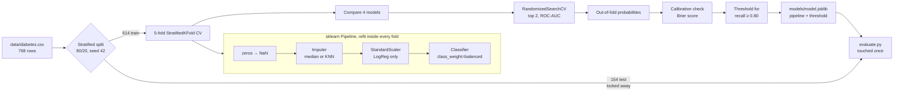
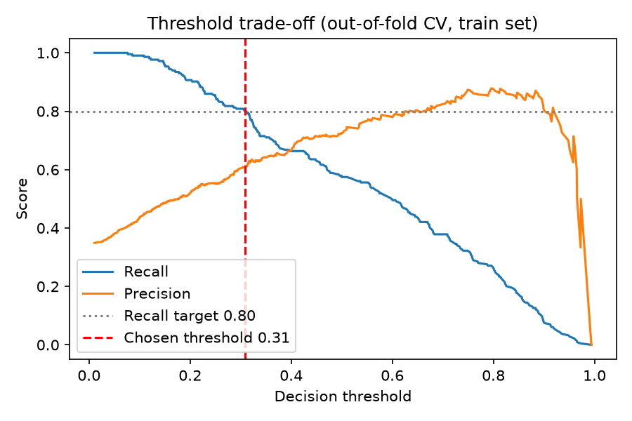
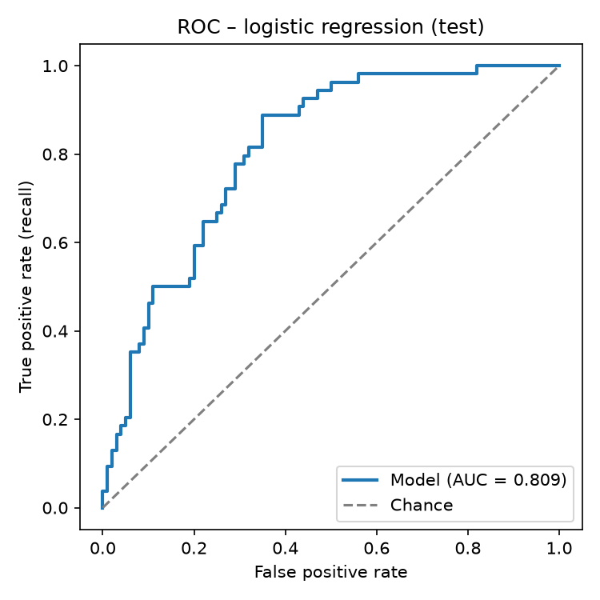
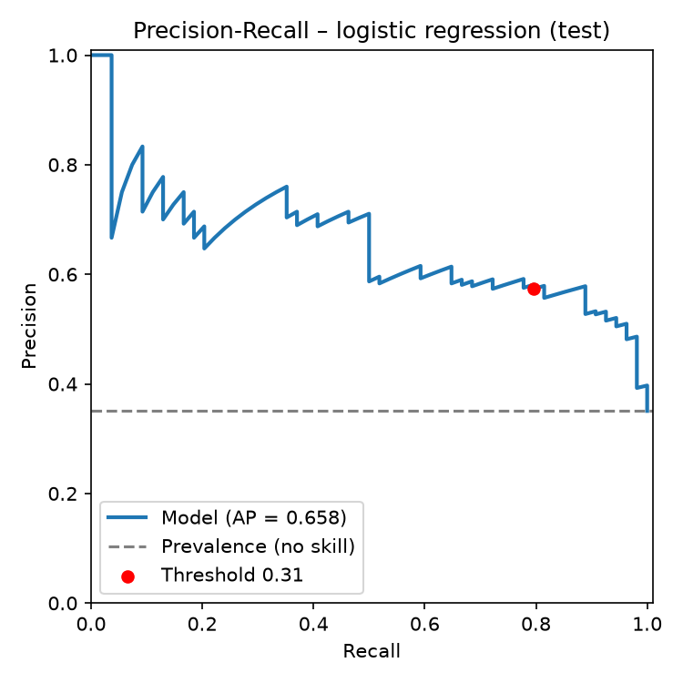
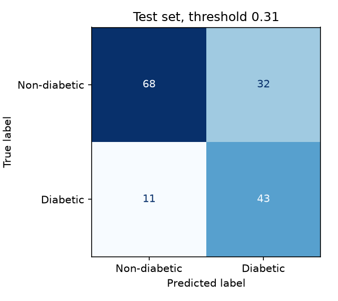
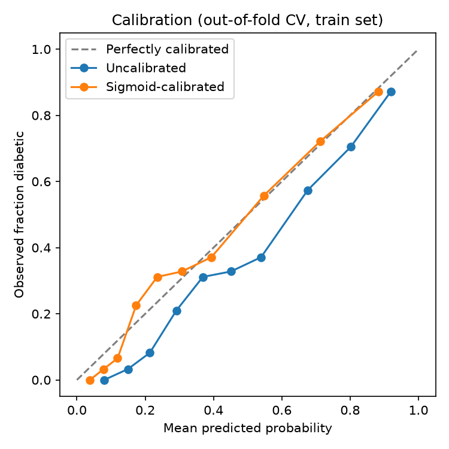
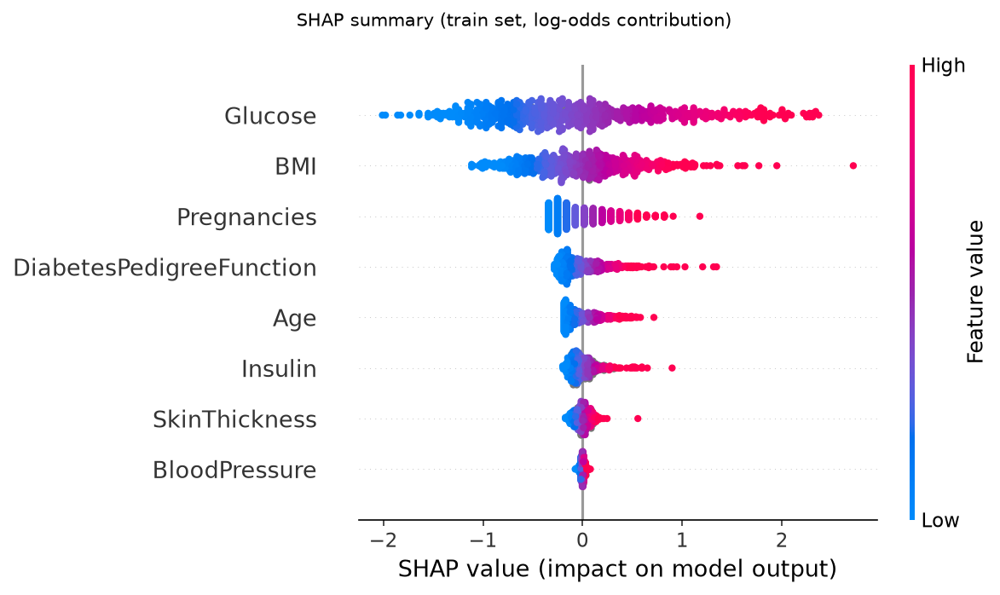
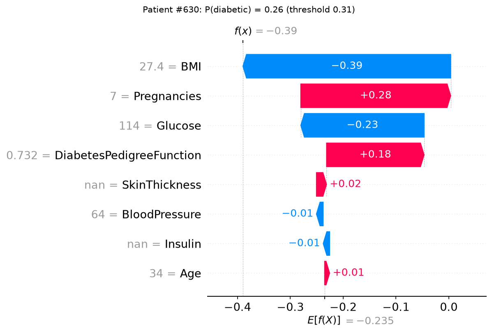

# Diabetes Risk Predictor

[](https://github.com/oussemagazzah/diabetes-risk-predictor/actions/workflows/ci.yml)

A leakage-free, recall-oriented screening model for type 2 diabetes on the Pima Indians Diabetes
dataset, with calibrated probabilities, SHAP explanations and a small Streamlit demo.

**Key result (held-out test set, 154 patients):** ROC-AUC **0.809** (95% CI 0.738–0.871) and
recall **0.796** (43 of 54 diabetic patients caught) at a decision threshold chosen on
cross-validation to target recall ≥ 0.80, with precision **0.573** and accuracy **0.721**.
Accuracy is deliberately not the target: a threshold chosen on CV to maximise accuracy only reaches
0.727 on the test set, and it misses 20 diabetic patients instead of 11
([why](#why-not-maximise-accuracy)).

> Every number in this README is read from [`reports/metrics.json`](reports/metrics.json), which is
> regenerated by `make train && make evaluate` (fixed seed, identical output across runs).

---

## 1. Problem: why recall matters

The task is to flag patients who should get a confirmatory diabetes test. In screening, the two
errors do not cost the same:

- **False negative** (a diabetic patient is told they're fine): the disease goes untreated and
  complications build up silently. **Expensive.**
- **False positive** (a healthy patient is sent for a blood test): one extra cheap test. **Cheap.**

So the model is tuned to **catch at least 80% of diabetic patients (recall ≥ 0.80)**, and we accept
more false alarms in exchange. Accuracy is a poor metric here: with 35% positives, predicting
"healthy" for everyone already scores about 65%.

## 2. Dataset and its limitations

- **Source:** originally collected by the US National Institute of Diabetes and Digestive and
  Kidney Diseases (NIDDK); first used in Smith et al., *"Using the ADAP learning algorithm to
  forecast the onset of diabetes mellitus"*, Proc. Symposium on Computer Applications in Medical
  Care, 1988. Distributed via the UCI Machine Learning Repository and
  [Kaggle](https://www.kaggle.com/datasets/uciml/pima-indians-diabetes-database). The CSV here
  (`data/diabetes.csv`) is that dataset, with the target column named `Diabetic`.
- **Size:** 768 patients, 8 numeric features, 268 diabetic (34.9%).
- **Population:** only **women of Pima Indian heritage, aged 21+**. The Pima have one of the highest
  recorded diabetes rates in the world, so results **should not be assumed to transfer** to men,
  other ethnic groups, younger patients, or populations with different prevalence.
- **Hidden missing values:** zeros that are physiologically impossible actually mean "not measured":
  Insulin 374 (48.7%), SkinThickness 227 (29.6%), BloodPressure 35, BMI 11, Glucose 5. They are
  converted to NaN and imputed (see [the EDA notebook](notebooks/01_eda.ipynb)).
- **Small test set:** 154 patients means wide confidence intervals (e.g. test recall CI 0.682–0.902).
  Treat point estimates with care.
- `Glucose` is a 2-hour oral glucose tolerance test, the same kind of test used to diagnose
  diabetes. Much of the model's signal comes from a near-diagnostic measurement, which limits its
  value for screening *before* any lab work.

## 3. Method



### Leakage prevention
1. **The split happens first.** The 20% test set is saved by index and only used once, in
   `evaluate.py`, which checks that the indices match the ones held out at training time.
2. **All preprocessing is inside the `Pipeline`.** Imputation and scaling statistics are learned on
   each training fold only, never on validation or test rows. (The original notebook ran
   `GridSearchCV` on the full dataset, so its reported score was inflated.)
3. **Every choice is made on training data only:** model comparison, hyperparameter tuning,
   imputer choice, whether to calibrate, and the decision threshold all use 5-fold CV or
   out-of-fold predictions on the train split.

### Models compared
Logistic Regression (baseline), Decision Tree, Random Forest, and `HistGradientBoostingClassifier`
(gradient boosting from scikit-learn, no extra dependency). All use **`class_weight="balanced"`** to
handle the 35/65 class imbalance: samples are weighted by `n / (2 · n_class)`, i.e. 1.43 for
diabetic and 0.77 for non-diabetic patients on the train split, so both classes count equally
in the loss.

### Tuning, calibration, threshold
- **Tuning:** `RandomizedSearchCV` (40 candidates, ROC-AUC) on the top 2 models. The imputer
  (median vs KNN) is part of the search space.
- **Calibration:** `class_weight="balanced"` makes the model over-estimate risk (it trains as if
  prevalence were 50%). Out-of-fold sigmoid calibration (`CalibratedClassifierCV`) lowered the
  Brier score from **0.161 to 0.151**, so the calibrated model is used. Sigmoid rather than isotonic,
  because isotonic overfits with about 600 samples.
- **Threshold:** the highest threshold whose **out-of-fold** recall on the train set is ≥ 0.80. It
  came out at **0.308**. The test set plays no part in choosing it.

## 4. Results

### Cross-validation on the train set (5-fold, default hyperparameters, threshold 0.5)

Mean ± std across folds:

| Model | ROC-AUC | PR-AUC | Recall | Precision | F1 | Accuracy |
|---|---|---|---|---|---|---|
| **Logistic regression** | **0.844 ± 0.016** | **0.748 ± 0.056** | 0.701 ± 0.039 | 0.649 ± 0.026 | 0.672 ± 0.013 | 0.762 ± 0.011 |
| Random forest | 0.824 ± 0.025 | 0.701 ± 0.045 | 0.701 ± 0.023 | 0.664 ± 0.042 | 0.681 ± 0.022 | 0.770 ± 0.023 |
| Hist. gradient boosting | 0.798 ± 0.022 | 0.677 ± 0.065 | 0.650 ± 0.063 | 0.644 ± 0.061 | 0.644 ± 0.046 | 0.749 ± 0.039 |
| Decision tree (depth 5) | 0.771 ± 0.027 | 0.625 ± 0.019 | 0.790 ± 0.044 | 0.570 ± 0.024 | 0.661 ± 0.019 | 0.718 ± 0.020 |

**After tuning** (CV ROC-AUC, mean ± std): logistic regression **0.846 ± 0.009** (C ≈ 0.068, KNN
imputer); random forest 0.840 ± 0.018 (median imputer, max_depth 4, 378 trees). Logistic regression was
selected.

Honest notes on these numbers:
- Tuning added little (0.844 → 0.846). On 8 mostly monotonic features and 614 rows, a regularised
  linear model is hard to beat, and the more flexible models mostly add variance.
- KNN imputation beat median imputation by only 0.0008 ROC-AUC (0.8458 vs 0.8450), far smaller
  than the fold-to-fold std. The two are effectively tied.

### Chosen operating point (out-of-fold, train set)

| Threshold | Recall | Precision | Specificity | F1 | Accuracy |
|---|---|---|---|---|---|
| 0.5 (default) | 0.575 | 0.728 | 0.885 | 0.642 | 0.777 |
| **0.308 (screening, chosen)** | **0.804** | **0.610** | 0.725 | 0.694 | 0.752 |
| 0.425 (max accuracy, comparison only) | 0.664 | 0.710 | 0.855 | 0.686 | 0.788 |

Lowering the threshold from 0.5 to 0.308 catches 49 more diabetic patients out of 214 in CV
(123 → 172), at the cost of 64 more false alarms out of 400 non-diabetic patients (46 → 110).



### Final test-set results (154 patients)

| Metric | **Screening threshold 0.308** | Max-accuracy threshold 0.425 | 0.5 (reference) | 95% bootstrap CI (at 0.308) |
|---|---|---|---|---|
| ROC-AUC | **0.809** | 0.809 | 0.809 | 0.738 – 0.871 |
| PR-AUC | **0.658** | 0.658 | 0.658 | 0.523 – 0.783 |
| Recall | **0.796** | 0.630 | 0.519 | 0.682 – 0.902 |
| Precision | **0.573** | 0.607 | 0.583 | 0.464 – 0.684 |
| F1 | **0.667** | 0.618 | 0.549 | 0.571 – 0.754 |
| Accuracy | **0.721** | 0.727 | 0.701 | 0.649 – 0.786 |
| Specificity | 0.680 | 0.780 | 0.800 | – |
| Brier score | 0.175 | 0.175 | 0.175 | – |

Confusion matrices: at 0.308 (screening), **43 TP, 11 FN, 32 FP, 68 TN**; at 0.425 (max accuracy),
34 TP, 20 FN, 22 FP, 78 TN.

The model, its hyperparameters and the screening threshold were all fixed before the test set was
first scored. The max-accuracy column was added afterwards, using a threshold that was also chosen
on CV only, so the test set has now been scored twice with the same model. This column is for
comparison and did not change any modelling choice.

- Test recall (0.796) is just below the 0.80 target. The threshold was fixed on CV, where recall was
  0.804, and **was not adjusted to the test set**, because doing so would leak test information into
  the model. With 54 diabetic test patients, one more caught case would mean recall 0.815, so this
  gap is within sampling noise (CI 0.682–0.902).
- Test ROC-AUC (0.809) is lower than CV ROC-AUC (0.846). That is expected with a small test set and
  a model chosen as the best of several on CV. The CV value lies inside the test CI.

### Why not maximise accuracy?

The model's quality, its ability to rank diabetic above non-diabetic patients, is measured by
ROC-AUC, and ROC-AUC does not depend on the threshold. Accuracy does: it only changes with where you
draw the line. The trade-off plot shows that **accuracy is almost flat (about 0.75–0.79) for
thresholds from 0.3 to 0.6, while recall collapses** over the same range. So:

- On CV, moving from the screening threshold to the max-accuracy threshold gains 3.6 accuracy
  points (0.752 → 0.788) but lowers recall from 0.804 to 0.664. That's 30 more missed diabetic
  patients out of 214 (42 → 72).
- On the test set the accuracy gain mostly disappears (0.721 → 0.727, one more correct patient out of
  154), while the recall loss does not: 0.796 → 0.630, nine more missed diabetic patients (11 → 20).
- For reference, always predicting "non-diabetic" scores 0.651 accuracy on the train split, with
  zero recall.

For a screening tool, missed diabetics are the expensive error, so the screening threshold stays.

| ROC curve | Precision–recall curve |
|---|---|
|  |  |

| Confusion matrix (threshold 0.308) | Calibration (CV, before/after sigmoid) |
|---|---|
|  |  |

Test-set calibration: [`calibration_test.png`](reports/figures/calibration_test.png).

### Explainability (SHAP)

Global feature effects on the training set (log-odds contributions of the underlying logistic
regression; sigmoid calibration is monotone, so it does not change the direction or ranking).
Glucose dominates (mean |SHAP| 0.741), followed by BMI (0.420) and Pregnancies (0.244). Blood
pressure contributes almost nothing (0.015).



**One patient, explained.** The example is chosen by a fixed rule (the first diabetic patient in
the test set), not cherry-picked. It turns out to be a **missed case**: P(diabetic) = 0.26, below the
0.31 threshold. Her moderate BMI (27.4) and glucose (114 mg/dL, below the 140 OGTT cut-off) push the risk down more than 7
pregnancies and a high pedigree score push it up. Insulin and skin thickness were not measured
(`nan`, imputed). This is the kind of patient a glucose-driven model will miss.



## 5. How to run

Requires **Python ≥ 3.12** (the pinned numpy/scipy/shap versions need it).

```bash
python -m venv .venv
source .venv/bin/activate          # Windows: .venv\Scripts\activate
pip install -r requirements.txt    # pinned versions + this package in editable mode
```

| Task | Make (Linux/macOS) | Windows PowerShell |
|---|---|---|
| Train (CV, tuning, calibration, threshold) | `make train` | `.\run.ps1 train` |
| Evaluate on test set + SHAP figures | `make evaluate` | `.\run.ps1 evaluate` |
| Tests | `make test` | `.\run.ps1 test` |
| Lint / format check | `make lint` | `.\run.ps1 lint` |
| Streamlit demo | `make app` | `.\run.ps1 app` |
| Re-execute the EDA notebook | `make eda` | `.\run.ps1 eda` |

`make train && make evaluate` regenerates every number and figure in this README (under a minute on a
laptop). Predict for one patient from the command line:

```bash
python -m diabetes_predictor.predict --pregnancies 6 --glucose 148 --blood-pressure 72 --skin-thickness 35 --bmi 33.6 --dpf 0.627 --age 50
```

Omitted lab values (insulin here) are treated as "not measured" and imputed.

## 6. Project structure

```
diabetes-risk-predictor/
├── data/diabetes.csv              # Pima Indians Diabetes dataset (768 × 9)
├── src/diabetes_predictor/
│   ├── config.py                  # paths, SEED, feature lists, experiment settings
│   ├── data.py                    # loading, zero→NaN, stratified split
│   ├── pipeline.py                # sklearn Pipelines for the 4 models
│   ├── train.py                   # CV comparison, tuning, calibration, threshold (train only)
│   ├── evaluate.py                # one-time test evaluation → reports/metrics.json + figures
│   ├── explain.py                 # SHAP summary + single-patient waterfall
│   ├── predict.py                 # CLI / function to score one patient
│   ├── metrics.py                 # metrics, threshold selection, bootstrap CIs
│   └── plots.py                   # ROC, PR, confusion matrix, calibration, threshold plots
├── app/streamlit_app.py           # demo: form → probability + SHAP explanation
├── notebooks/01_eda.ipynb         # executed EDA
├── reports/
│   ├── figures/                   # generated figures
│   ├── cv_results.json            # generated by train.py
│   └── metrics.json               # generated by evaluate.py (CV + test)
├── models/                        # model.joblib (gitignored; regenerate with make train)
├── tests/                         # pytest: data, pipeline, metrics (21 tests)
├── .github/workflows/ci.yml       # ruff + pytest on Python 3.12 / 3.13
├── requirements.txt, pyproject.toml, Makefile, run.ps1
```

## 7. What I'd do next

- **More and more diverse data, plus external validation.** Test on a different cohort (e.g. NHANES)
  to check whether performance holds outside this population, and recalibrate if prevalence differs.
- **Fairness and subgroup checks.** Recall and calibration by age band and BMI range. The dataset
  has no sex or ethnicity variation, so those subgroups can't be checked at all.
- **Missing-value modelling.** Add "was-missing" indicator features (in the EDA the diabetic rate is a bit higher
  when Insulin or SkinThickness is missing: 36.9% vs 33.0% and 38.8% vs 33.3%), and compare multiple imputation.
- **A pre-lab model.** Drop Glucose and Insulin to see how well risk can be screened from
  non-invasive measurements only (BMI, age, pregnancies, family history).
- **Repeated / nested CV** to get a less noisy estimate than a single 154-patient test set, and a
  decision-curve analysis to choose the threshold from explicit costs instead of a fixed recall
  target.

## 8. Disclaimer

This is an **educational project, not a medical device**. It has not been clinically validated
and must not be used to diagnose, treat or make any health decision. It was trained on 768 Pima
Indian women aged 21 and over, so its predictions may not apply to other populations.

---

*History: this repo started as a class lab (Colab notebook `Tp2.ipynb`, exported as `script.py`).
It was rebuilt to fix data leakage in its hyperparameter search, missing-value handling, and
reproducibility. The original code is preserved in the git history.*
